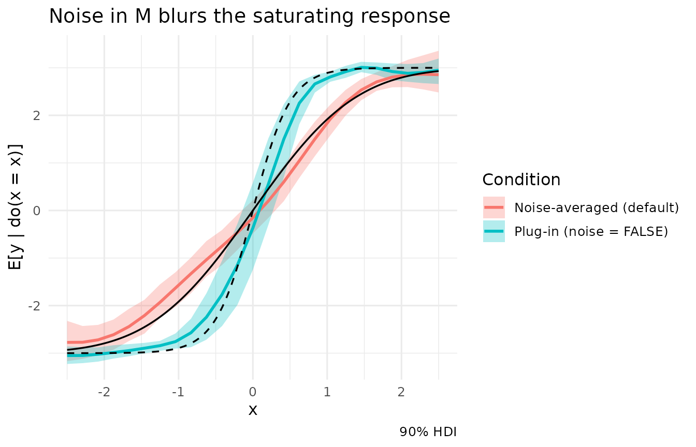

# Noise and the interventional mean

Every node in a structural causal model has two parts: a **mechanism**
(how it responds to its parents) and **exogenous noise** (everything
else that moves it). When Kagu estimates the effect of an intervention,
it has to decide what to do with that noise as the intervention ripples
through the graph. This vignette covers:

- the mathematics of the choice,
- why the obvious shortcut (ignore the noise) is only exact for linear
  mechanisms,
- why including the noise does *not* inflate the uncertainty of an
  effect,
- comparisons on a very simple graph.

> **Note:** To keep the focus on the demonstration, this vignette skips
> the full Bayesian workflow of checking priors before fitting and model
> fit afterwards. With real data you should do both: see
> [`vignette("predictive_checks")`](https://causalabs.github.io/kagu-r/articles/predictive_checks.md).

## The estimand

Take the simplest graph with a mediator, \\X \to M \to Y\\, with
additive noise:

\\ M = f(X) + \varepsilon_M, \qquad Y = g(M) + \varepsilon_Y, \qquad
\mathbb{E}\[\varepsilon_M\] = \mathbb{E}\[\varepsilon_Y\] = 0 . \\

Intervening with \\\mathrm{do}(X = x)\\ cuts every arrow *into* \\X\\
and fixes it at \\x\\. The noise terms are untouched: each unit keeps
its own \\\varepsilon_M\\ and \\\varepsilon_Y\\. The average causal
effect is defined through the **interventional mean**

\\ \mu(x) \\=\\ \mathbb{E}\big\[Y \mid \mathrm{do}(X = x)\big\] \\=\\
\int g\big(f(x) + \varepsilon\big)\\ p(\varepsilon_M = \varepsilon)\\
d\varepsilon , \\

and the effects Kagu reports are contrasts or derivatives of it:
\\\mu(x_1) - \mu(x_0)\\, or \\\mu'(x)\\.

The target’s own noise \\\varepsilon_Y\\ has already dropped out: it is
added *after* \\g\\, so its mean of zero passes straight through. The
mediator’s noise is different, because it enters *inside* \\g\\.

## The plug-in shortcut

The tempting shortcut is to push conditional means through the graph and
set every noise term to zero:

\\ \tilde\mu(x) \\=\\ g\big(f(x)\big). \\

This is the effect in a world where the exogenous variation has been
switched off. It equals \\\mu(x)\\ exactly when \\g\\ is **linear**,
whatever the distribution of the noise:

\\ g(m) = a + b\\m \\\Rightarrow\\ \mathbb{E}\big\[a + b\\(f(x) +
\varepsilon_M)\big\] = a + b\\f(x) = \tilde\mu(x). \\

Once \\g\\ curves, the two differ. This is Jensen’s inequality, and a
second-order Taylor expansion shows the size of the gap:

\\ \mu(x) \\\approx\\ g\big(f(x)\big) + \tfrac12\\
g''\big(f(x)\big)\\\sigma_M^2 . \\

The bias grows with the curvature of the downstream mechanism and with
the variance of the noise feeding it. Two worked cases:

- **Exponential**, \\g(m) = e^{m}\\ with Gaussian noise: \\\mu(x) =
  e^{f(x) + \sigma_M^2 / 2}\\, so every effect is inflated by a factor
  \\e^{\sigma_M^2/2}\\ relative to the plug-in.
- **Saturating**, \\g(m) = \tanh(m)\\: \\\mu\\ is \\g\\ *convolved with
  the noise density*, \\\mu(x) = (g \* p\_{\varepsilon_M})(f(x))\\. The
  noise blurs the threshold, so the true dose-response is shallower than
  the plug-in near the threshold and less flat in the tails.

The question is never whether the noise is Gaussian. Gaussian noise
feeding a non-linear mechanism still produces a gap, and non-Gaussian
noise feeding a linear one produces none. **Non-linearity downstream of
a noisy node is the whole story.** Non-Gaussian outcome families matter
only because their link functions are one such non-linearity.

Kagu models every mechanism as a Gaussian process, so curvature is
learned from the data rather than ruled out. That is why it averages
over the noise by default.

## Noise without inflated uncertainty

A natural worry is that carrying the noise through the graph inflates
the uncertainty, with nuisance variation compounding along long paths.
That is true for one quantity and false for another, and the distinction
matters.

Let \\\theta\\ be one posterior draw: one set of mechanism functions and
noise scales. For that draw the model defines a full distribution of
outcomes under the intervention, \\p\_\theta(Y \mid \mathrm{do}(x))\\.
Two different summaries of it can be reported:

1.  **A sample from it.** Draw the noise once and push it through.
    Across posterior draws this gives the *posterior predictive*
    distribution of one unit’s outcome. It contains every nuisance term,
    and it does widen along long paths. It answers “what might *this
    individual’s* outcome be?”
2.  **Its mean**, \\\mu\_\theta(x) = \mathbb{E}\_\theta\[Y \mid
    \mathrm{do}(x)\]\\. This is a single number per draw. The noise has
    been *integrated out*, not carried along. Across draws, its spread
    reflects only **epistemic** uncertainty: what we do not know about
    the mechanisms.

An average causal effect is built from quantity 2. In regression terms
this is the difference between a prediction interval and a confidence
interval for the mean.

When no closed form exists, Kagu computes \\\mu\_\theta\\ by Monte
Carlo. The observed rows are treated as the population: every row is a
unit, and for each posterior draw Kagu propagates all of them and
averages:

\\ \hat\mu\_\theta(x) \\=\\ \frac{1}{K} \sum\_{k=1}^{K}
g\_\theta\big(f\_\theta(x) + \sigma\_{M,\theta}\\ z_k\big). \\

Three details keep the Monte Carlo error negligible next to the
posterior spread:

- **Common random numbers.** The same units \\z_1, \dots, z_K\\ are
  reused for both arms of a contrast and for every point of a sweep, so
  their errors largely cancel in \\\hat\mu\_\theta(x_1) -
  \hat\mu\_\theta(x_0)\\. A contrast of \\x\\ with itself is exactly
  zero, and gradients are stable.
- **Stratification.** The \\z_k\\ are stratified normal quantiles, one
  per equal-probability stratum, so a handful of units already covers
  the noise distribution evenly. Strata are paired at random across
  nodes, as in a Latin hypercube.
- **Root nodes** carry no mechanism. Each unit keeps its observed
  values, so the average is over exactly the population in the data and
  adds no sampling noise. If there are fewer rows than `n_mc` and a
  noisy node lies on the path, the rows are replicated, each copy with
  its own noise, until there are `n_mc` units.

The posterior over the effect is therefore \\\\\hat\mu\_\theta(x_1) -
\hat\mu\_\theta(x_0)\\\\ over draws \\\theta\\. Its width does not grow
with path length.

## Example 1: a linear chain

When every mechanism is linear the two approaches must agree.

``` r

n <- 200
x <- rnorm(n)
m <- 2.0 * x + rnorm(n, sd = 1)
y <- -1.5 * m + rnorm(n, sd = 0.5)
lin <- data.frame(x, m, y)

dag <- list(x = c(), m = "x", y = "m")
mod_lin <- KaguModel$new(dag)
mod_lin$fit(lin)
```

The true effect of a unit change in \\x\\ is \\2.0 \times -1.5 = -3\\.

``` r

rbind(
  mod_lin$effects("x", "y", values = c(0, 1))$summary(),               # noise-averaged (default)
  mod_lin$effects("x", "y", values = c(0, 1), noise = FALSE)$summary() # plug-in
)
#> # A tibble: 2 × 8
#>   source target  from    to  mean    sd hdi_lower hdi_upper
#>   <chr>  <chr>  <dbl> <dbl> <dbl> <dbl>     <dbl>     <dbl>
#> 1 x      y          0     1 -2.81 0.129     -3.01     -2.60
#> 2 x      y          0     1 -2.80 0.130     -3.01     -2.59
```

The two rows match: no curvature means no Jensen gap.

## Example 2: a saturating mechanism

Now keep the same graph but make \\Y\\ saturate in \\M\\, a common shape
for dose-responses, thresholds and bounded outcomes:

\\ M = X + \varepsilon_M, \quad \varepsilon_M \sim N(0, 1); \qquad Y = 3
\tanh(2M) + \varepsilon_Y, \quad \varepsilon_Y \sim N(0, 0.2^2). \\

``` r

set.seed(1)
x <- rnorm(n)
m <- x + rnorm(n, sd = 1)
y <- 3 * tanh(2 * m) + rnorm(n, sd = 0.2)
sat <- data.frame(x, m, y)

mod_sat <- KaguModel$new(dag)
mod_sat$fit(sat)
```

Because we simulated the data, we know both curves. The interventional
mean averages \\g\\ over the mediator’s noise; the plug-in ignores it:

``` r

z         <- qnorm(ppoints(20000))   # integrates over N(0, 1) noise
true_mean <- function(x) vapply(x, function(xi) mean(3 * tanh(2 * (xi + z))), numeric(1))
plug_in   <- function(x) 3 * tanh(2 * x)

c(interventional = true_mean(1) - true_mean(0), plug_in = plug_in(1) - plug_in(0))
#> interventional        plug_in 
#>       1.916855       2.892083
```

The two estimands differ by about 50%. Kagu’s estimates:

``` r

eff_avg  <- mod_sat$effects("x", "y", values = c(0, 1))
eff_plug <- mod_sat$effects("x", "y", values = c(0, 1), noise = FALSE)
rbind(eff_avg$summary(), eff_plug$summary())
#> # A tibble: 2 × 8
#>   source target  from    to  mean    sd hdi_lower hdi_upper
#>   <chr>  <chr>  <dbl> <dbl> <dbl> <dbl>     <dbl>     <dbl>
#> 1 x      y          0     1  2.00 0.274      1.51      2.41
#> 2 x      y          0     1  3.16 0.561      2.19      3.98
```

The noise-averaged default is close to the true interventional effect,
which sits inside its interval. The plug-in is aimed at a different
number: it estimates the noise-free contrast, about 50% larger. Neither
is exact, because a stationary GP fitted to 200 points rounds off the
sharp step in \\\tanh(2m)\\, and that error affects both modes alike.

The default’s interval is also *narrower* than the plug-in’s. The
plug-in evaluates each function draw only at \\f(0)\\ and \\f(1)\\, on
the steep middle of \\\tanh\\, where the GP’s draws disagree most.
Averaging over the noise spreads each draw across the whole curve, which
smooths out that disagreement.

The difference is clearest across the whole dose-response. Each sweep
curve shows the posterior mean and 90% HDI of \\\mathbb{E}\[Y \mid
\mathrm{do}(X = x)\]\\, with the true interventional mean (solid) and
the noise-free curve (dashed) overlaid:

``` r

sw_avg  <- mod_sat$effects("x", "y", sweep = TRUE, sweep_n = 25, sweep_range = c(-2.5, 2.5))
sw_plug <- mod_sat$effects("x", "y", sweep = TRUE, sweep_n = 25, sweep_range = c(-2.5, 2.5),
                           noise = FALSE)

grid  <- seq(-2.5, 2.5, length.out = 200)
truth <- data.frame(x = grid, interventional = true_mean(grid), plug_in = plug_in(grid))

sw_avg$plot(compare = list("Plug-in (noise = FALSE)" = sw_plug),
            base_label = "Noise-averaged (default)") +
  geom_line(data = truth, aes(x = x, y = interventional), inherit.aes = FALSE,
            linewidth = 0.6) +
  geom_line(data = truth, aes(x = x, y = plug_in), inherit.aes = FALSE,
            linewidth = 0.6, linetype = "dashed") +
  labs(title = "Noise in M blurs the saturating response")
```



The plug-in sweep follows \\3\tanh(2x)\\, a steep switch. Real units do
not behave that way: at \\\mathrm{do}(X = 0)\\ half of them already sit
well above the threshold because of \\\varepsilon_M\\. The
noise-averaged sweep tracks the true, gentler interventional curve.

## Example 3: a root node that modifies the effect

Root nodes raise the same question. Under the plug-in, a root that is
not intervened on is fixed at its mean. If the effect depends on that
root non-linearly, “the effect for an average unit” and “the average
effect” come apart.

Here \\Z\\ is a root, and the effect of \\X\\ on \\Y\\ scales with
\\Z^2\\:

\\ Y = X \cdot Z^2 + \varepsilon_Y, \qquad X, Z \sim N(0, 1). \\

Each unit’s effect is \\Z^2\\, so the average effect is
\\\mathbb{E}\[Z^2\] = 1\\. The unit at the mean of \\Z\\ (that is, \\Z =
0\\) has no effect at all.

``` r

xx <- rnorm(n)
zz <- rnorm(n)
yy <- xx * zz^2 + rnorm(n, sd = 0.3)
mod_root <- KaguModel$new(list(x = c(), z = c(), y = c("x", "z")))
mod_root$fit(data.frame(x = xx, z = zz, y = yy))

rbind(
  mod_root$effects("x", "y", values = c(0, 1))$summary(),
  mod_root$effects("x", "y", values = c(0, 1), noise = FALSE)$summary()
)
#> # A tibble: 2 × 8
#>   source target  from    to    mean     sd hdi_lower hdi_upper
#>   <chr>  <chr>  <dbl> <dbl>   <dbl>  <dbl>     <dbl>     <dbl>
#> 1 x      y          0     1  0.866  0.0421     0.790    0.924 
#> 2 x      y          0     1 -0.0166 0.0527    -0.104    0.0647
mean(zz^2)   # the true average effect in this observed population
#> [1] 0.8993912
```

The default averages over the observed population of \\Z\\ and recovers
its average effect, the sample mean of \\Z^2\\ printed last (close to 1,
the average in an infinite population). The plug-in reports the effect
for a unit at \\Z = \bar z \approx 0\\, which is close to zero. Both are
legitimate quantities, but only the first is the average treatment
effect. When you want the effect at a particular value of a root, ask
for it explicitly with `conditions`:

``` r

mod_root$effects("x", "y", values = c(0, 1), conditions = list(z = 0))$summary()
#> # A tibble: 1 × 8
#>   source target  from    to    mean     sd hdi_lower hdi_upper
#>   <chr>  <chr>  <dbl> <dbl>   <dbl>  <dbl>     <dbl>     <dbl>
#> 1 x      y          0     1 -0.0219 0.0518    -0.105    0.0611
mod_root$effects("x", "y", values = c(0, 1), conditions = list(z = 1.5))$summary()
#> # A tibble: 1 × 8
#>   source target  from    to  mean     sd hdi_lower hdi_upper
#>   <chr>  <chr>  <dbl> <dbl> <dbl>  <dbl>     <dbl>     <dbl>
#> 1 x      y          0     1  2.31 0.0749      2.19      2.44
```

## Monte Carlo accuracy

Roots add no Monte Carlo error, because every observed row is used. The
only Monte Carlo error comes from the noise of non-root nodes, and
stratification keeps that small. `n_mc` is the minimum number of units
per draw: with 200 rows the default of 50 leaves them as they are, and
asking for 1000 replicates each row five times with fresh noise. Nothing
changes:

``` r

do.call(rbind, lapply(c(50, 1000), function(k) {
  s <- mod_sat$effects("x", "y", values = c(0, 1), n_mc = k)$summary()
  data.frame(n_mc = k, mean = s$mean, sd = s$sd)
}))
#>   n_mc     mean        sd
#> 1   50 1.992778 0.2744895
#> 2 1000 1.992762 0.2794440
```

With very few rows, or many noisy nodes feeding strongly non-linear
mechanisms, check that `sd` does not fall as `n_mc` grows, and increase
it until it settles.

## Which should you use?

|  | `noise = TRUE` (default) | `noise = FALSE` |
|----|----|----|
| Estimand | \\\mathbb{E}\[Y \mid \mathrm{do}(x)\]\\, the interventional mean | \\g(f(x))\\, the response with noise switched off |
| Root nodes | averaged over the observed rows (the data are the population) | fixed at their mean |
| Equal when | always the target | every downstream mechanism is linear |
| Uncertainty | epistemic only | epistemic only |
| Cost | up to one mechanism evaluation per row per draw | cheapest |

Use the default for average causal effects. `noise = FALSE` is useful
for fast exploratory sweeps. It is also useful when the noise-free
mechanism is itself the quantity of interest, for example a physical
response curve measured with instrument error. Either way the effect’s
uncertainty describes what we do not know about the mechanisms, never
the scatter between individual units.
